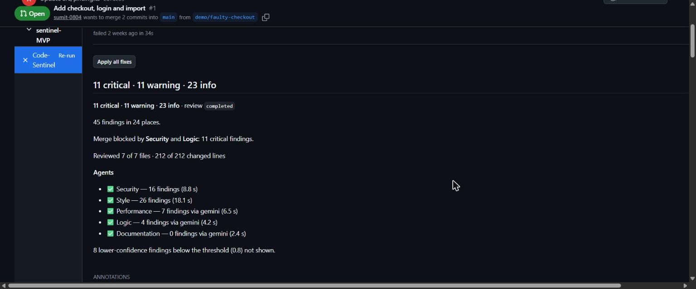
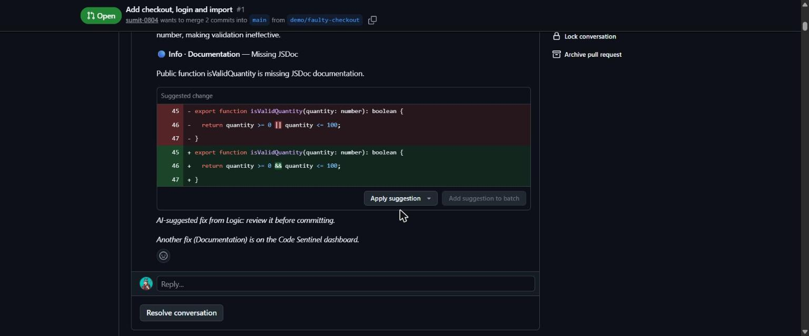
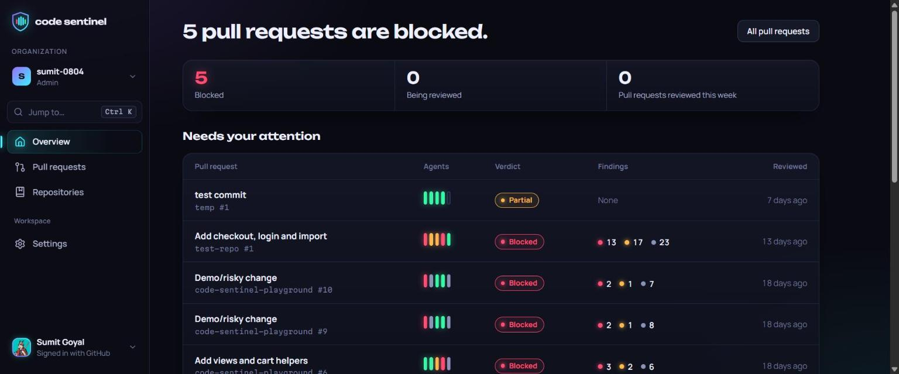
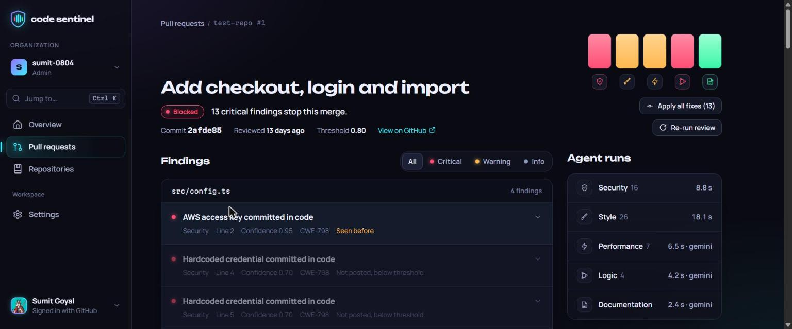
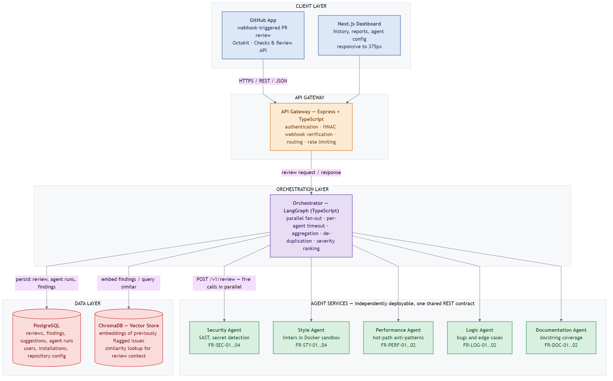

# Code-Sentinel

[](https://github.com/sumit-0804/CodeSentinel/actions/workflows/ci.yml)

A multi-agent code review platform built on a service-oriented architecture.

**Live app:** <https://codesentinel.scribly.fun> (dashboard) · <https://api.codesentinel.scribly.fun/healthz> (API status)

Review work is split across five independent agent services — **Security, Style, Performance,
Logic, Documentation**. A LangGraph orchestrator fans a review request out to the agents in
parallel, then aggregates, de-duplicates and severity-ranks their findings into one combined
report. The platform is reachable from a GitHub App and a Next.js dashboard.

See [`docs/`](docs/) for the Proposal, Plan, Requirements Specification (BRD) and System Design
Document, and [`docs/design/`](docs/design/) for the architecture diagrams, OpenAPI contracts and
database schema. Hosting, CI/CD and security settings are in [`docs/DEPLOYMENT.md`](docs/DEPLOYMENT.md).

## Features

**Pull request review (GitHub App)**

- Opening or updating a pull request starts a review. A **Code-Sentinel Check Run** shows "in
  progress" within seconds and finishes as pass, fail or neutral.
- Five agents run in parallel, each with its own timeout: Security (rules + AI), Style (ESLint,
  Prettier, Ruff, Black; no AI), Performance, Logic and Documentation.
- Findings from different agents on the same lines are **clubbed into one comment** ("Flagged by
  Security and Logic"), ranked by severity and posted as inline review comments.
- Fixes are one click: a committable suggestion on each comment, and **Apply all fixes** on the Check
  Run, which makes one commit. The new commit is reviewed again.
- **"Seen before"**: a finding similar to an earlier one in the same organization links to it
  (pgvector similarity search over Gemini embeddings).
- Large pull requests are handled without failing: generated, binary and oversized files are
  skipped and listed, and the Check Run says how many files were reviewed.
- A redelivered webhook is ignored, and a new push cancels the review of the older commit.

**Dashboard**

- Sign in with email and password, GitHub or Google. Optional authenticator app (TOTP); once added,
  settings changes, fixes and signing out a device ask for a code.
- Connect repositories by installing the GitHub App; organizations and repositories sync on their own.
- **Overview**: what is blocked or being reviewed, agent health notices, recent reviews.
- **Repositories**: reviews on or off, each agent Off / Comment / Block merge, confidence threshold,
  branches to review, open pull requests with **Review now** / **Re-run**.
- **Pull requests**: every pull request's latest review; the review page shows live progress while
  agents run, findings by file, and **Commit fix** / **Dismiss** / **Apply all fixes**.
- **Settings**: profile and linked accounts, organization review defaults, signed-in devices
  (sign any of them out), and the audit log for admins.

**Operations**

- Rate limits per installation, per user and per IP; an audit log of every sensitive action.
- Prometheus metrics, a Grafana dashboard and four alerts ([`docs/monitoring/`](docs/monitoring/)).
- LLM quota is reserved before each call (Groq first, then Gemini), so the free tiers are never exceeded.

| | |
| --- | --- |
|  |  |
|  |  |

## How it fits together



| Layer | What | Where it lives |
| --- | --- | --- |
| Frontend | Next.js 16 dashboard (Tailwind v4, shadcn/ui). The browser only talks to the dashboard's own server, which calls the gateway with the user's Supabase token | [`apps/dashboard`](apps/dashboard/README.md) |
| Backend | Express gateway (webhooks, auth, `/v1` API, publishing to GitHub) → LangGraph orchestrator (fan-out, timeouts, aggregation, context) → five agent services | [`services/`](services/) |
| Database | Supabase Postgres with pgvector, 18 tables, through Prisma 7. Gateway and orchestrator share it; reviews survive restarts | [`packages/db`](packages/db/README.md), [schema diagram](docs/design/diagrams/database_schema.png) |
| Auth | Supabase Auth (email, GitHub, Google, TOTP). The gateway verifies each access token against Supabase's JWKS and checks the session is still live | [gateway README](services/gateway/README.md#authentication) |

One review, end to end: GitHub sends a webhook → the gateway checks its signature, stores the
review and creates the Check Run → the orchestrator plans the LLM budget and calls the agents in
parallel → it merges, de-duplicates and ranks the findings and saves the report → the gateway posts
the comments and completes the Check Run → the dashboard reads the same rows through the gateway.

## APIs and integrations

**Our own APIs** are specified in OpenAPI and mirrored as zod schemas in
[`packages/contracts`](packages/contracts/README.md), which every service imports:

| API | Spec | Used by |
| --- | --- | --- |
| Gateway `/v1` (reviews, repositories, config, fixes, sessions, audit log, agent health) and `/webhooks/github` | [`gateway.yaml`](docs/design/openapi/gateway.yaml) | dashboard, GitHub |
| Orchestrator `/internal/v1/review-jobs` | [`orchestrator.yaml`](docs/design/openapi/orchestrator.yaml) | gateway |
| Agent `/v1/review`, `/v1/capabilities` (the same contract for all five) | [`agent.yaml`](docs/design/openapi/agent.yaml) | orchestrator |

**External services:**

| Service | Used for |
| --- | --- |
| GitHub App (webhooks, Checks, Pull Request Reviews, Git Data, OAuth) | Receiving PR events, posting the Check Run and comments, committing fixes, connecting repositories |
| Groq (`openai/gpt-oss-120b`) and Google Gemini | The agents' AI reviews (Groq first, Gemini as fallback); Gemini embeddings for "Seen before" |
| Supabase | Postgres + pgvector, and sign-in (email, GitHub, Google, TOTP) |
| Resend | Sign-up and password-reset emails, sent through Supabase Auth |
| Grafana Cloud | Metrics, dashboard and alerts |

## Repository layout

```
apps/            User-facing apps
  dashboard/     Next.js 16 dashboard — Supabase Auth (email, GitHub, Google), app shell, onboarding
services/        Deployable services (one per SOA component)
  gateway/       Express API gateway — webhook receipt, auth, routing to the orchestrator
  orchestrator/  LangGraph orchestrator — review-job API, fan-out, aggregation, severity ranking, context
  security-agent/ Security Agent — SAST and secret rules on added lines, plus an LLM pass over the whole files
  style-agent/   Style Agent — ESLint/Prettier and Ruff/Black in a per-request sandbox (Docker, or a child process on Render), no LLM
  performance-agent/ Performance Agent — N+1 queries, blocking calls and repeated work, by LLM over the whole files
  logic-agent/   Logic Agent — null handling, off-by-one and unhandled errors, by LLM over the whole files
  documentation-agent/ Documentation Agent — docstrings for public code the PR touches, by LLM (always info)
packages/        Shared libraries
  contracts/     zod schemas + types mirroring docs/design/openapi (every service imports these)
  llm/           Groq (primary) and Gemini (secondary) clients, quota budget, Gemini embeddings
  agent-kit/     Shared base of the agent services — agent.yaml routes, per-file skips, deadline, diff parsing, LLM pass
  service-kit/   Shared HTTP plumbing — JSON logger, request id, request log, ApiError handler, env file
  db/            Prisma 7 schema, migrations and client for the Supabase Postgres database
docs/            Course deliverables and design artifacts
render/          Render Blueprints (gateway, orchestrator, agents)
Dockerfile       One image per service (--build-arg SERVICE=<name>); the style-agent has its own
```

Every agent gets each changed file whole (up to the gateway's `FILE_CONTENT_MAX_BYTES`) with the
pull request's lines marked, and reports findings only on added lines. Files linked by imports are
reviewed in the same LLM call, and every call also sees the rest of the pull request's diffs.

## Getting started

Requires Node.js 22.12+ (Prisma 7 and the Prometheus client need Node 22). The database setup is in
[`packages/db/README.md`](packages/db/README.md).

```bash
npm install
npm run lint
npm run build
npm run test
npm run typecheck
```

The monorepo uses npm workspaces with [Turborepo](https://turbo.build/) for task running.

To run the pipeline locally:
- Copy each service's `.env.example` to `.env`, all seven with the same `SERVICE_TOKEN`.
- Point the gateway's `ORCHESTRATOR_URL` and the orchestrator's `AGENT_<KIND>_URL` at `http://127.0.0.1:<port>`: Security 8081, Style 8082, Performance 8083, Logic 8084, Documentation 8085. An agent without a URL is skipped ("Not deployed" on the PR page).
- Each LLM agent reads its own `GROQ_API_KEY`. Groq limits are per account, so an agent can use another account's key; name the account in the orchestrator's `GROQ_ACCOUNT_<KIND>` so it gets its own quota budget. All agents can share one `GEMINI_API_KEY` as the fallback.
- The gateway and the orchestrator use Supabase when `DATABASE_URL` is set (the same value in both), and memory otherwise. See the [gateway](services/gateway/README.md#persistence) and [orchestrator](services/orchestrator/README.md#persistence) Persistence sections.

Then, after `npm run build`, start each service in its own terminal:

```bash
npm run start -w @code-sentinel/orchestrator
```

```bash
npm run start -w @code-sentinel/security-agent
```

```bash
npm run start -w @code-sentinel/style-agent
```

```bash
npm run start -w @code-sentinel/performance-agent
```

```bash
npm run start -w @code-sentinel/logic-agent
```

```bash
npm run start -w @code-sentinel/documentation-agent
```

```bash
npm run start -w @code-sentinel/gateway
```

Each service README has a step-by-step manual check.

The dashboard runs on `http://localhost:3001` after copying `apps/dashboard/.env.example` to `.env.local`; see
[`apps/dashboard/README.md`](apps/dashboard/README.md). It calls the gateway from its server, so start the
gateway first with `DATABASE_URL` and `SUPABASE_URL` set (the gateway README's sign-in check):

```bash
npm run dev -w @code-sentinel/dashboard
```

## Continuous integration

[`.github/workflows/ci.yml`](.github/workflows/ci.yml) runs on every pull request and on every push
to `main` and `dev`. The `checks` job runs on Node 22 and Node 24 (`fail-fast: false`, so one version
failing still reports the other) and executes, from a clean `npm ci`:

```bash
npm run lint       # ESLint flat config (eslint.config.mjs), every workspace
npm run build      # Turborepo builds contracts before its dependants
npm run typecheck
npx prisma migrate deploy   # in packages/db, against the job's Postgres service
npm run test
```

Each leg gets a throwaway `pgvector/pgvector:pg16` Postgres service. `DATABASE_URL` and
`TEST_DATABASE_URL` point at it, so the migrations are applied fresh and `packages/db`'s integration
tests run on every push.

A second job, `ci`, waits for both matrix legs and fails unless every leg succeeded. It runs even
when a leg fails or is skipped (`if: always()`), because GitHub counts a skipped required check as
passing. **`ci` is the only check branch protection needs to require.** Superseded runs on the
same ref are cancelled, and the workflow token is read-only.

### Branch protection

Branch protection is a repository setting, not a file. A repository admin enables it once:

1. Settings → Branches → Add branch ruleset (or classic branch protection rule) for `main`.
2. Turn on "Require status checks to pass before merging" and add `ci`.
3. Turn on "Require branches to be up to date before merging".

Or with the GitHub CLI:

```bash
gh api -X PUT repos/sumit-0804/CodeSentinel/branches/main/protection --input - <<< '{"required_status_checks":{"strict":true,"contexts":["ci"]},"enforce_admins":false,"required_pull_request_reviews":null,"restrictions":null}'
```

A pull request whose `ci` check fails then shows "Merging is blocked".

### Validating the workflow locally

[actionlint](https://github.com/rhysd/actionlint) checks the workflow syntax, expressions and
job references without pushing. From the repo root, with Docker running (macOS / Linux shell):

```bash
docker run --rm -v "$(pwd):/repo" -w /repo rhysd/actionlint:latest -color
```

On Windows, run the same command from PowerShell with `"${PWD}:/repo"` as the volume.

No output and exit code 0 means the workflow is valid.

## Deployment

| Part | Where | URL |
| --- | --- | --- |
| Dashboard | Vercel | `https://codesentinel.scribly.fun` |
| Gateway | Render, workspace A | `https://api.codesentinel.scribly.fun` (GitHub webhook: `/webhooks/github`) |
| Orchestrator | Render, workspace B | its `onrender.com` URL, called only by the gateway |
| Five agents | Render, workspace C | their `onrender.com` URLs, called only by the orchestrator |
| Database and sign-in | Supabase (dev project) | |

Everything runs on free plans. Each service redeploys after CI passes on `main`, and the gateway
applies database migrations when it starts. Metrics and alerts are on Grafana Cloud.

The full notes are in [`docs/DEPLOYMENT.md`](docs/DEPLOYMENT.md): hosting, setup steps, CI/CD,
security configuration, monitoring and the latest live check.

## Team

| Area | Members |
| --- | --- |
| Orchestration | Sumit Goyal, Durgesh |
| Agent Services | Tej Prakash Tak, Nevil Nandasana, Parin Makwana |
| Backend & Database | Ayush Soni |
| Integrations & DevOps | Vatsal Kamani |
| Frontend | Moksh Mehta |
