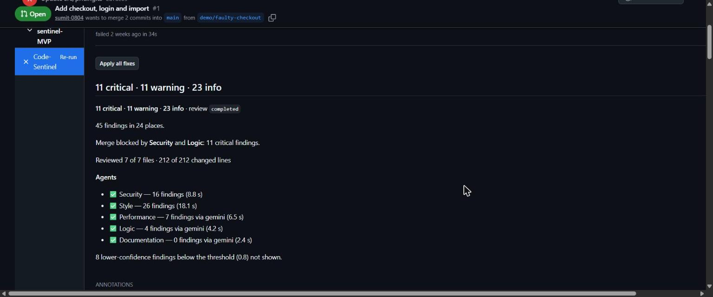
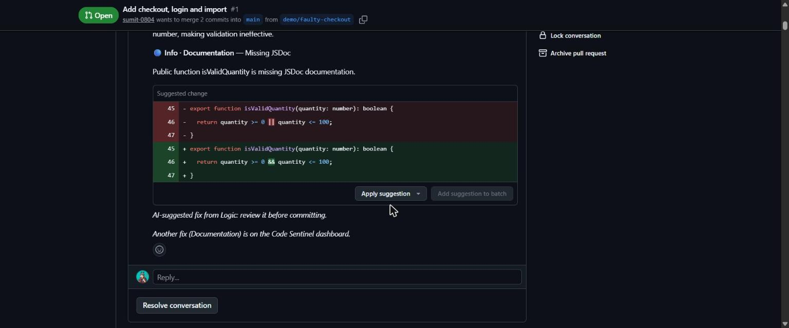
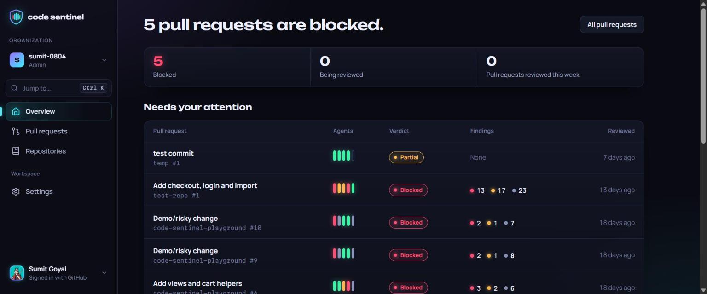
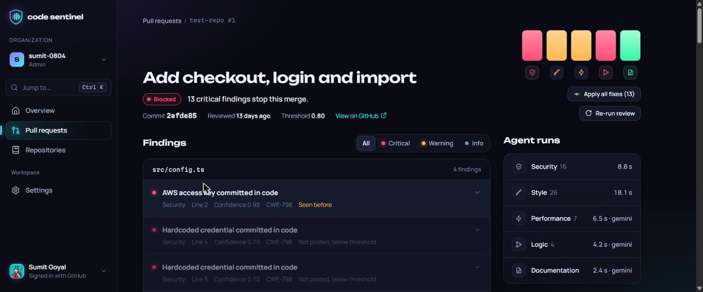
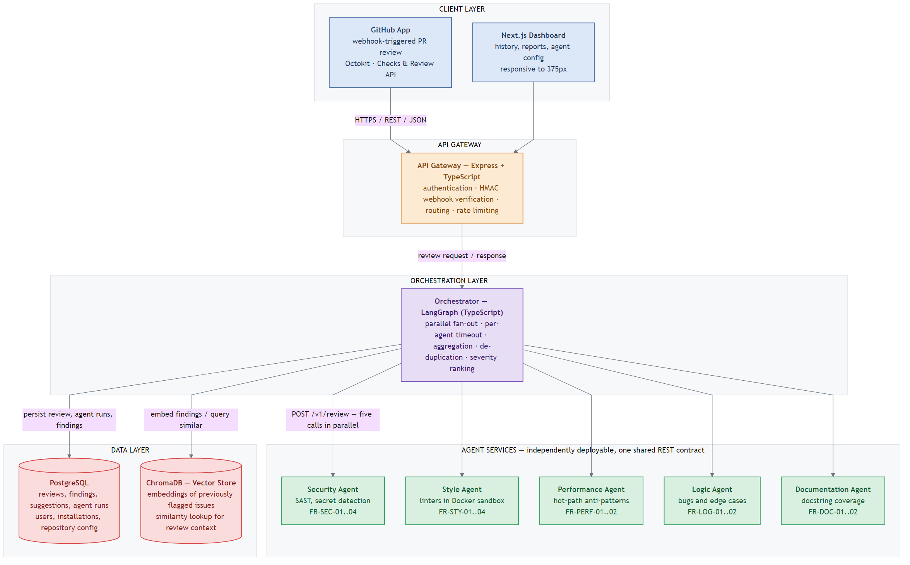

# Code-Sentinel

[](https://github.com/sumit-0804/CodeSentinel/actions/workflows/ci.yml)

Code-Sentinel reviews pull requests automatically. Five independent agents (**Security, Style,
Performance, Logic, Documentation**) read the changed code in parallel, and their findings come
back as one review on the pull request, with fixes you can commit in a click.

**Live app:** <https://codesentinel.scribly.fun> · **API status:** <https://api.codesentinel.scribly.fun/healthz>

| | |
| --- | --- |
|  |  |
|  |  |

## What it does

**On GitHub**

- Opening or updating a pull request starts a review. A Check Run appears within seconds.
- Findings from different agents on the same lines are merged into one comment and ranked by severity.
- Each comment carries a fix you can commit. **Apply all fixes** commits them all at once.
- A finding similar to an earlier one in your organization is marked "Seen before".

**On the dashboard**

- Sign in with email, GitHub or Google, with an optional authenticator app.
- Connect repositories, and set each agent to Off, Comment or Block merge.
- Follow a review while it runs, read findings by file, commit or dismiss fixes.
- Review history, signed-in devices and an audit log for admins.

## How it fits together



| Part | What | More |
| --- | --- | --- |
| Dashboard | Next.js 16 app. The browser only talks to the dashboard's own server | [`apps/dashboard`](apps/dashboard/README.md) |
| Gateway | Express: webhooks, sign-in checks, the `/v1` API, publishing to GitHub | [`services/gateway`](services/gateway/README.md) |
| Orchestrator | LangGraph: calls the agents in parallel, merges and ranks findings | [`services/orchestrator`](services/orchestrator/README.md) |
| Five agents | One service each, all behind the same API | [`services/`](services/) |
| Database and sign-in | Supabase Postgres with pgvector, through Prisma 7; Supabase Auth | [`packages/db`](packages/db/README.md) |
| Shared packages | API schemas, LLM clients, agent and service helpers | [`packages/`](packages/) |

One review, end to end: GitHub sends a webhook → the gateway checks it and creates the Check Run →
the orchestrator calls the agents → it merges and ranks their findings → the gateway posts the
comments → the dashboard shows the same review.

## Getting started

Requires Node.js 22.12 or newer.

```bash
npm install
```

```bash
npm run build
```

```bash
npm run test
```

To run the whole pipeline locally:

1. Copy each service's `.env.example` to `.env`, all seven with the same `SERVICE_TOKEN`.
2. Set up the database: [`packages/db/README.md`](packages/db/README.md).
3. Start the agents, the orchestrator and then the gateway, each in its own terminal:

   ```bash
   npm run start -w @code-sentinel/gateway
   ```

   The other workspaces are `orchestrator`, `security-agent` (port 8081), `style-agent` (8082),
   `performance-agent` (8083), `logic-agent` (8084) and `documentation-agent` (8085).
4. Start the dashboard on `http://localhost:3001`:

   ```bash
   npm run dev -w @code-sentinel/dashboard
   ```

Each README under [`services/`](services/) and [`apps/dashboard`](apps/dashboard/README.md) lists
its environment variables and a step-by-step check.

## Where to find more

| Topic | Location |
| --- | --- |
| Proposal, plan, requirements, design and reports | [`docs/`](docs/) |
| Architecture diagrams and database schema | [`docs/design/`](docs/design/) |
| API specifications (OpenAPI) | [`docs/design/openapi/`](docs/design/openapi/) |
| Hosting, CI/CD, branch protection, security and monitoring | [`docs/DEPLOYMENT.md`](docs/DEPLOYMENT.md) |
| CI workflow | [`.github/workflows/ci.yml`](.github/workflows/ci.yml) |

## Deployment

| Part | Where |
| --- | --- |
| Dashboard | Vercel, `https://codesentinel.scribly.fun` |
| Gateway, orchestrator, five agents | Render |
| Database and sign-in | Supabase |

Everything runs on free plans, and each service redeploys after CI passes on `main`. Details are in
[`docs/DEPLOYMENT.md`](docs/DEPLOYMENT.md).

## Team

| Area | Members |
| --- | --- |
| Orchestration | Sumit Goyal, Durgesh |
| Agent Services | Tej Prakash Tak, Nevil Nandasana, Parin Makwana |
| Backend & Database | Ayush Soni |
| Integrations & DevOps | Vatsal Kamani |
| Frontend | Moksh Mehta |
