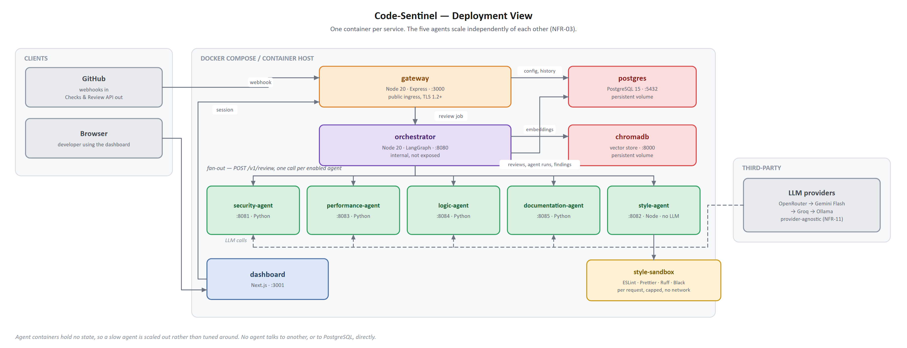

# Deployment notes

How Code-Sentinel is hosted, how it is deployed, and the security settings in place.

## Public URLs

| What | URL |
| --- | --- |
| Dashboard (the app) | <https://codesentinel.scribly.fun> |
| API status | <https://api.codesentinel.scribly.fun/healthz> |
| GitHub webhook | `https://api.codesentinel.scribly.fun/webhooks/github` |
| Source code | <https://github.com/sumit-0804/CodeSentinel> |

## Hosting

| Part | Where | URL |
| --- | --- | --- |
| Dashboard (Next.js) | Vercel | `https://codesentinel.scribly.fun` |
| Gateway | Render, workspace A (Docker, Singapore) | `https://api.codesentinel.scribly.fun` |
| Orchestrator | Render, workspace B | its `onrender.com` URL, called only by the gateway |
| Five agents | Render, workspace C | their `onrender.com` URLs, called only by the orchestrator |
| Database (Postgres + pgvector) and sign-in | Supabase | |
| Emails | Resend, through Supabase Auth | from `no-reply@codesentinel.scribly.fun` |
| Metrics, dashboard, alerts | Grafana Cloud | |
| DNS | Hostinger | `codesentinel` → Vercel, `api.codesentinel` → Render |
| Keep-warm pings | cron-job.org | both `/healthz` URLs every 10 minutes |



Everything runs on free plans:

- **Three Render workspaces.** Render gives each workspace 750 free hours a month, and a free
  service sleeps after 15 idle minutes. GitHub waits only about 10 s for a webhook answer, so the
  gateway and the orchestrator have a workspace each and stay awake (about 720 hours each).
- **Keep-warm job.** A [cron-job.org](https://cron-job.org) job requests both `/healthz` URLs every
  10 minutes.
- **Agents sleep.** The orchestrator wakes each one through `/healthz` before its review call
  (`AGENT_WAKE_TIMEOUT_MS=90000`). The first review after a quiet period takes about a minute longer.
- **Public calls between services.** Workspaces don't share a private network, so each hop is a
  public HTTPS call with `SERVICE_TOKEN`.

## Images

The root [`Dockerfile`](../Dockerfile) builds any service from its pruned workspace
(`turbo prune`) and runs it as the non-root `node` user. Render passes the `SERVICE` env var as the
build arg:

```bash
docker build --build-arg SERVICE=gateway -t cs/gateway .
```

The style-agent has its own [`Dockerfile`](../services/style-agent/Dockerfile), with the linters
installed and `SANDBOX_MODE=process`. Render can't run Docker inside a service; see the
[style-agent README](../services/style-agent/README.md#process-mode-render).

## Setting it up

**Render.** One Blueprint per workspace: [`render/gateway.yaml`](../render/gateway.yaml),
[`render/orchestrator.yaml`](../render/orchestrator.yaml) and [`render/agents.yaml`](../render/agents.yaml).
In each workspace: **New → Blueprint**, pick this repo and the file, then type the values marked
`sync: false`:

- **Secrets:** `SERVICE_TOKEN` (the same everywhere), `DATABASE_URL`, the GitHub App and LLM keys,
  and `METRICS_TOKEN`.
- **Service URLs:** the other workspaces' `onrender.com` URLs.
- **The gateway also needs** the Secret File `github-app.pem`.

**Vercel, Supabase and the GitHub App:** see the
[dashboard README](../apps/dashboard/README.md#deploy-vercel). **Database:**
[`packages/db/README.md`](../packages/db/README.md#supabase-setup-once-per-project).

**DNS (Hostinger):**

- `api.codesentinel`: CNAME to the gateway's `onrender.com` host
- `codesentinel`: CNAME to Vercel's target

## CI/CD

**CI** is [`.github/workflows/ci.yml`](../.github/workflows/ci.yml), on every pull request and
every push to `main`:

| Step | What it checks |
| --- | --- |
| `npm ci` | a clean install from the lockfile |
| `npm run lint` | ESLint, every workspace |
| `npm run build` | every package and service builds |
| `npm run typecheck` | TypeScript, strict |
| `npx prisma migrate deploy` | all migrations apply to a fresh `pgvector/pgvector:pg16` database |
| `npm run test` | unit and integration tests, including the database tests |

- It runs on Node 22 and Node 24. A final `ci` job fails unless both passed; it is the one check
  branch protection requires.
- The workflow token is read-only (`permissions: contents: read`), and a newer run on the same
  branch cancels the older one.

**CD:**

- **Render** redeploys a service only after CI passes on `main` (`autoDeployTrigger: checksPass`)
  and only when that service's own paths changed (`buildFilter`). Each service has a `/healthz`
  health check, so a build that doesn't start never replaces the running one.
- **Database migrations** run on gateway start (`npm run start:deploy` runs `prisma migrate deploy`
  first), because free Render services have no pre-deploy step.
- **Vercel** builds the dashboard from `main` with [`apps/dashboard/vercel.json`](../apps/dashboard/vercel.json).

## Security configuration

| Area | Setting |
| --- | --- |
| Transport | HTTPS only on both domains, with HSTS |
| Sign-in | Supabase Auth: email + password (8+ characters, letters and digits), GitHub, Google. Access tokens last 10 minutes |
| API auth | The gateway verifies every `/v1` token against Supabase's JWKS (ES256, issuer, audience, role) and checks the session is still signed in, so sign-out works at once |
| Two-factor | Optional authenticator app (TOTP). Once added, settings changes, connecting GitHub, fixes and signing out a device need a code from the last 10 minutes |
| Roles | Only organization admins change configuration or read the audit log; members see only the repositories they can open on GitHub |
| Webhooks | GitHub's HMAC signature is checked before anything else; an unsigned delivery gets 401 |
| Service to service | Orchestrator and agents accept only calls carrying `SERVICE_TOKEN` |
| Rate limits | 300/min per installation on webhooks, 120/min and 20 writes/min per user, 20 failed sign-ins per 15 min per IP; Supabase's own limits on sign-in and password reset |
| Database | Row-level security on every table with no policies, so Supabase's public key reads nothing; only the `prisma` role reaches the tables |
| Secrets | Only in Render, Vercel and Supabase settings, never in the repo (`.env*` and `*.pem` are git-ignored). GitHub user tokens are encrypted at rest (AES-256-GCM, `FIELD_ENCRYPTION_KEY`) |
| Browser | The browser never calls the gateway; the dashboard's server does. CSP, `X-Frame-Options: DENY`, `nosniff`, `Referrer-Policy` and `Permissions-Policy` on every page; `helmet` on the gateway |
| Metrics | `/metrics` needs `METRICS_TOKEN` |
| Audit | Every sensitive action is recorded with user, IP and browser (`audit_events`) |
| Style sandbox | Linters run as a non-root child process in a per-request temp folder with a timeout and memory cap; the code under review is never executed |
| Containers | Services run as the non-root `node` user |

Details: [gateway README](../services/gateway/README.md#authentication) (authentication, rate
limits, audit log) and [dashboard README](../apps/dashboard/README.md#how-auth-works).

## Monitoring

On Grafana Cloud (free stack), from [`docs/monitoring/`](monitoring/):

- **Scraping:** two **Metrics Endpoint** scrape jobs read `/metrics` once a minute with `METRICS_TOKEN`
  as the bearer token: `https://api.codesentinel.scribly.fun/metrics` (gateway) and the
  orchestrator's `https://….onrender.com/metrics`.
- **The agents aren't scraped:** a scrape every minute would keep all five awake and use up their
  workspace's free hours. The orchestrator reports their runs, latency, last known health
  (`agent_health`) and LLM quota instead.
- **Dashboard:** [`code-sentinel.json`](monitoring/code-sentinel.json), imported with Dashboards → New
  → Import. It covers scrape status, requests, the 5xx share, latency, webhooks, rate limits, agent runs,
  latency and health, LLM quota, similar-issue lookups, memory and event-loop lag.
- **Alerts:** [`alerts.yaml`](monitoring/alerts.yaml), imported with Alert rules → More → Import →
  Prometheus YAML file. They email the default policy's contact point:

  | Alert | Fires when |
  | --- | --- |
  | `CodeSentinelServiceDown` | `/metrics` unreadable for 5 min |
  | `CodeSentinelAgentDown` | an agent's runs failed or timed out for 30 min with no success (learned from reviews, so a sleeping agent never counts) |
  | `CodeSentinelGatewayErrors` | over 5% of gateway requests are 5xx for 5 min |
  | `CodeSentinelLlmQuotaLow` | any LLM key under 15% of its quota |

## Live check (11 Nov 2026)

| Check | Result |
| --- | --- |
| `GET https://api.codesentinel.scribly.fun/healthz` | 200, `orchestrator: ok`, `database: ok` |
| `GET https://codesentinel.scribly.fun/` signed out | redirects to sign-in; `/sign-in` 200 |
| `GET /v1/me` with no token | 401 `unauthenticated` |
| `POST /webhooks/github` with no signature | 401 `invalid_signature` |
| `GET /metrics` with no token | 401 |
| Security headers on the dashboard | CSP, HSTS, `X-Frame-Options: DENY`, `nosniff` present |
